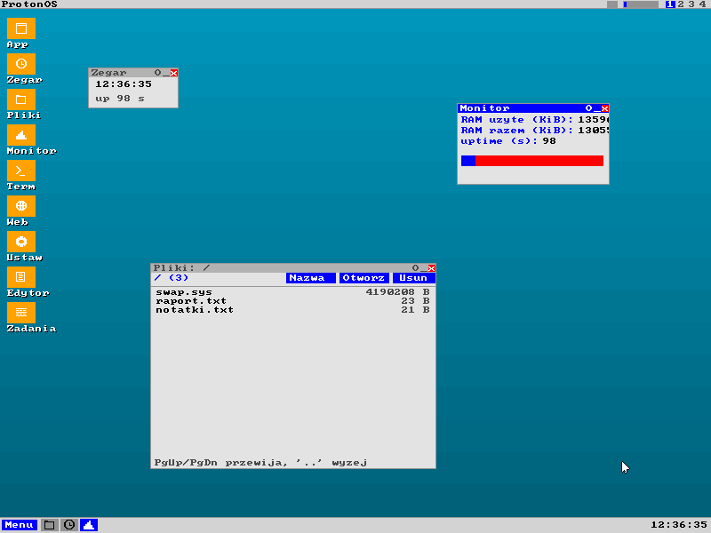
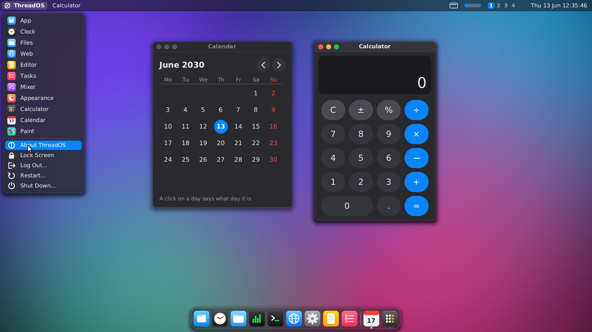
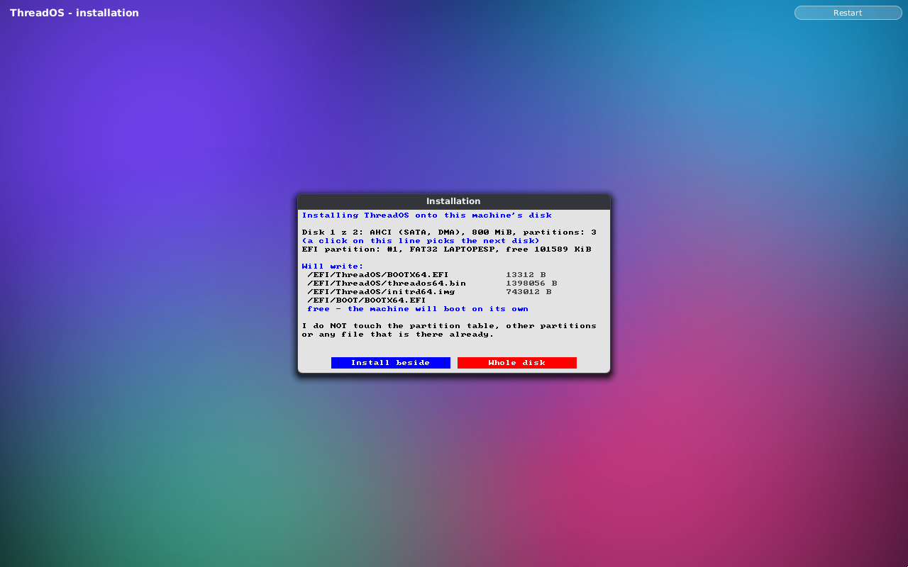

# ThreadOS

[](LICENSE)

A hobby operating system for PC, written from scratch in C and assembly.

There are **two kernels and one set of sources**. One runs in 32-bit
protected mode; the other enters long mode (x86-64) and boots on
machines without a BIOS, through UEFI. They are not two copies of the
same thing: drivers, filesystem, networking and console are the *same
files compiled twice*, and only what genuinely depends on the CPU mode —
paging, interrupts, context switching — has separate implementations.

Both kernels are Multiboot-compliant, so GRUB or QEMU can load them
directly — and on a UEFI machine the 64-bit kernel is loaded by
**threadboot**, this project's own EFI boot loader (`boot/efi/`), with no
GRUB involved at all.

## Screenshots

Both pictures are taken by `scripts/screenshots.py`, which boots the
64-bit kernel in QEMU, clicks its way through the system and dumps the framebuffer -
the same machinery the test suite uses, so what is below is what the
kernel actually drew.



The desktop, running on the loader's framebuffer: a menu bar of glass
along the top, a dock at the bottom, windows with round corners and
soft shadows that can be dragged, resized, tiled and closed. Every
window is a ring 3 program talking to the compositor; the fonts are the
kernel's own.



The same desktop on a 1920x1080 panel at a scale of one and a half:
laid out at 1280x720, drawn at the panel's own size - every edge and
every letter worked out in the panel's pixels, the programs' windows
too - with the menu open on its system part.



`install` on a UEFI machine, having found the disk, read its GPT and
its EFI partition, and listing the three files it is about to write -
before writing anything. It gets the whole screen, with no dock and no
other window to click by mistake.

The system and its source are both in English; the development
journal is the one thing that stayed Polish, and
[CONTRIBUTING.md](CONTRIBUTING.md#language-english-everywhere-the-code-can-be-read)
says why.

## What works

Shared by both kernels (same files, compiled twice):

| | |
|---|---|
| Hardware | PIC, PIT, PS/2 keyboard, serial port, PCI, RTC, local APIC |
| USB | xHCI, EHCI (with its UHCI companion) and UHCI behind one host-controller layer; HID boot keyboard |
| Storage | ATA PIO, AHCI (SATA, DMA) and NVMe behind one block layer |
| Sound | Intel HD Audio — the controller reset, the codec's widget graph walked, a stream fed from a ring buffer; volume and mute as a percentage of what the codec's amplifier really has (`beep`, `volume`, and a mixer window) |
| Disks | NVMe, every AHCI port, both ATA drives — a list, with one in use; the installer asks which |
| Installing | `install` takes the whole screen — no bar, no dock, no other window. Two ways: beside another system (three files onto the EFI partition that is already there, nothing else touched) or the whole disk (a GPT of our own, a fresh FAT32 EFI partition and a TFS3 partition) |
| FAT | FAT12/16/32 on the EFI partition — read fully, written as far as an installer needs, long names both ways |
| Filesystem | TFS3 — block bitmap, inodes, directories, files up to 64 MiB |
| Programs | ELF from the initrd **or** from disk (`cp`, then `run`) |
| Network | RTL8139 and e1000 behind one netdev layer; ARP, ICMP, UDP, DHCP, TCP, DNS |
| Ring 3 | The same programs built twice: crypto, TLS 1.3, HTTP, HTML, GUI apps |
| Linking | `libthread.so` — crypto, TLS, HTTP and DNS in one shared object, bound at load time |
| Display | VGA mode 13h and the loader's framebuffer (24/32 bpp) |
| Fonts | TrueType read and drawn in the kernel, anti-aliased, in integer arithmetic only — glyphs, advances and boxes identical to FreeType's (hinting off), coverage within a few 1/255ths; DejaVu Sans and Sans Mono, Latin-1 and Latin Extended-A |
| Settings | `system.cfg` on the disk — machine name, name server, prompt colour, desktop background, light or dark theme, dock size, how windows move |

Programs that use crypto link against a real shared object: the kernel
loads `libthread.so` once at a fixed address, maps its code and
constants into every process as the *same physical frames*, gives each
process a private copy of its writable data, and fills in the jump
tables from the ELF relocations before the first instruction runs. The
four heaviest programs together are now smaller than the library they
share.

**32-bit kernel** — ring 3 processes with `fork`/`exec`, copy-on-write,
swap to disk, signals, pipes, four virtual consoles, USB keyboard
(xHCI, EHCI or UHCI), ACPI, files mapped into memory for reading *and
writing*, a stack that grows on demand, processes **and the threads of
one process** running in ring 3 on every core — a changed mapping is
sent to the other cores and awaited before the frame is reused — TLS
1.3 with certificate verification, and a graphical desktop of light and
glass — an aurora of soft colour behind everything, a menu bar the
background shows through blurred, windows with round corners standing
on soft shadows, their close, minimise and zoom buttons as three
coloured lights, and a dock of tiles that starts programs and holds the
open windows. All of it is drawn with anti-aliased edges by the
kernel's own small graphics library (rounded rectangles, circles, lines,
shadows and a two-pass blur, each held to the exact area of the shape
by a test), in two themes — dark and light, a setting the desktop
follows while it runs. Which window is listening shows in its lights,
its title bar and the dot under its tile in the dock. The tiles carry
pictures drawn from shapes rather than labels — the desktop remembers
which tile started which process, so a window wears the face of the
program it belongs to — and pointing at one names it. How large the
dock is is a setting kept on the disk, and so is the wallpaper, if the
aurora will not do — a small picture computed by a program in ring 3,
written to the disk and stretched over the screen behind everything
else. The launch menu hangs from the mark at the left end of the bar
and carries the same pictures as the dock. Which programs the dock
holds is a text file on the disk — one line each, buildable from the
machine's own shell — falling back to the built-in nine when it says
nothing usable. The programs draw the way the desktop draws — two system
calls hand them the same soft-edged shapes and TrueType lettering, and
the theme's colours, which they follow the moment the theme changes —
so the settings, the file manager, the task manager, the clock, the
monitor, the mixer, the installer, the terminal, the editor and the
browser look like the desktop they stand on — the last three in DejaVu
Sans Mono on a grid of cells, because their columns have to stay
columns. There is a calculator that counts in millionths rather than
binary fractions (0.1 + 0.2 is 0.3), a calendar, and a paint program
whose drawings the picture viewer opens; Ctrl+Alt+L (or 'lock') locks
the screen behind the admin's password, and the bottom of the menu does
what the end of a session needs — Lock Screen, Log Out, Restart, Shut
Down — the last three only after a question in words with a Cancel next
to it — and the Windows key opens that menu for the arrows and Enter.
A dock tile has a menu under the right button (Show, Minimise, Close;
Open), and the bar's date and memory meter open the calendar and the
task manager. AltGr types the Polish letters (the programmer's layout:
ą ć ę ł ń ó ś ź ż, with Shift the capitals) on PS/2 and USB keyboards
alike, as UTF-8 - and the editor, the terminal, the fields and the
search take a letter of two bytes as one letter. Ctrl+Space opens a search under the bar that finds programs, open
windows, settings and files as they are typed; notifications slide in
at the top right — from the shell, from any program, from the desktop
itself when it saves a picture of the screen; and "Appearance" shows
the two themes and the seven backgrounds as pictures of themselves,
drawn by the kernel, to be chosen by looking at them. Windows grow out
of nothing as they open and shrink into their tile when minimised, at a
pace the 'motion' setting chooses (or not at all). With
windows that can be moved, resized, maximised to fill the screen and
closed like anywhere else — the compositor asks an application to end,
an application may answer "not yet" and keep its window (the editor
does, when the file has unsaved changes), and the compositor insists on
silence alone — twelve of them at once, in a dock that makes its tiles
smaller rather than letting them run off the edge, with the date and a
clock at the right-hand end of the bar. Print Screen saves what is on
the screen to a file in the colours the compositor drew — glass and
shadows included — and the picture viewer puts them back into a window
through a block-of-pixels call — and reads BMP, PNG and
baseline JPEG files too — the deflate decoder is the machine's own, and
so are the Huffman codes, the cosine transform undone in fixed point
and the colour put back from half resolution — so a machine that takes
a picture of itself can also look at what a camera wrote, and look at
it in the colours it was written in: a window holds palette indices, as
every program here always drew, or asks once to hold colours instead
and then a photograph is a photograph rather than a photograph seen
through thirty-six crayons. The compositor writes to the card only the
rows that actually changed, so an idle desktop redrawn fifty times a
second sends nothing at all across the bus — and spends a few per cent
of each second drawing, the dock's glass kept between frames while
nothing it shows or stands on changes. The screen runs in the
panel's own resolution — read from its EDID where the system can (its
own UEFI loader asks the firmware for it and switches GOP to it; QEMU's
VGA is read directly), whatever the loader set where it cannot, and the
'resolution' setting where a person says otherwise — and on a panel with
more pixels to the inch the desktop is laid out at a scale (from the
EDID's physical size, or the panel's height: 1080 rows is one and a
half) but drawn at the panel's own size: every edge worked out in the
panel's pixels, every letter rendered from its outline at one and a half
times the size, the programs' windows kept in the panel's pixels too —
sharp, not blown up. A laptop's touchpad is a mouse with a wheel: the
fourth byte is asked for the way it has to be asked for, and two
fingers sliding on the pad scroll the window under the pointer — not
the one with the keyboard. A pointer that is not on the PS/2 port at
all works too: a USB mouse in the HID boot protocol, next to the USB
keyboard that was already there, so a machine with no 8042 controller —
which is what a laptop made in the last few years is — still has both. A window can be renamed by the program
that owns it, so the editor's title says which file it holds and the
terminal's says where it is standing. A file
manager that lists sizes, walks into directories and back out, hands a
file to the editor, renames one where it stands and throws one away
when asked twice, a web browser, a task manager that lists what is
running and ends a program that has stopped answering (it refuses to
end a kernel thread, or itself), a text editor — a white page with a caret, a
status line that is the whole of its interface, Ctrl+S, Ctrl+O, Ctrl+F that searches and goes round the end of the
file, Ctrl+Z that takes back the last hundred and twenty changes, the desktop's own clipboard, a file named on the command line opened at
once, and an "Edytuj" button in the file manager that hands a file to
it — and a settings window whose changes
survive a restart. The terminal in a window is a dark screen with light text and
a session in it: scrollback, history, a movable cursor, Tab that
finishes a file name from the directory (and lists the candidates when
several fit), `cd` and pipes,
output that appears while the program is still writing it, Ctrl+C to
stop it, and a pipe into what it started — so the ring 3 shell runs
inside the terminal window, its children writing where it writes, and
Ctrl+D ends it. One program compiled for both kernels, differing only
in how a command is started. Alt+Tab moves the focus from the keyboard,
Alt+F4 closes the window that has it — by asking the application, the
same way its [x] does — the right mouse button opens the launch menu
where the pointer is, a window dragged against an edge takes that half
of the screen (or all of it, at the top), with an outline showing where
it will land before the button is let go, a double click on a title bar fills the screen and
gives the size back, the menu bar carries what is always true — which of the four
desktops this is, and a meter of how much of the machine is spoken for,
with the figures one hover away, and a button that puts every window
out of the way and then brings back exactly those it hid — four virtual desktops switch
with Ctrl+Alt and an arrow — with Shift the focused window comes along,
and a program on a desktop nobody is looking at goes on running — and
Ctrl+Insert /
Shift+Insert move text between windows through a clipboard the kernel
holds, and dragging the mouse across a terminal's output selects it —
which copies it, the way it does everywhere else. Two privilege levels: changing the system —
its settings and the files it keeps them in — needs an admin, and the
way up is a password, asked for by the shell, by the terminal and by
the settings window alike (`sudo`), for one command at a time.

**64-bit kernel** — long mode, four-level paging with NX, `syscall`/
`sysret`, processes with `fork`/`exec`/`wait` and copy-on-write,
signals, file descriptors, pipes, on-demand heap, SSE with FPU state
saved across context switches, a shell in the kernel *and* one in user
space, networking from ring 3, TLS 1.3 with certificate verification,
a graphical desktop whose six applications all run in ring 3, shared
memory, files mapped into memory for reading *and writing*, a stack
that grows on demand, swap to disk, processes that run in ring 3 on
every core, **threads sharing one address space across cores**, four
virtual consoles, USB keyboard (xHCI, EHCI or UHCI), ACPI power-off, and
BIOS + UEFI boot from a single hybrid disc — the latter through our own
EFI loader, which reads the kernel and the initrd off the EFI system
partition, sets the graphics mode through GOP, takes the ACPI pointer
from the firmware, builds the Multiboot 2 tag table itself, leaves long
mode and jumps.

**A C library, and JavaScript** — the 64-bit programs can be built
against **musl** (unchanged upstream 1.2.5, `third_party/musl`): stdio,
malloc, printf, strtod, files, errno, fork and wait. Eight of its files
are replaced (`libc/overlay`) so that every Linux system call it makes
goes through one function that speaks ThreadOS to the kernel — musl
never learns it is not on Linux. The first program nobody wrote for
ThreadOS runs on it: **QuickJS** (`third_party/quickjs`), behind `js` —
a console, `js file.js`, `js -e …` — with files, timers and an event
loop, and a `console.log` that prints exactly what Node.js prints.
The tests hold both up against the real thing: a C program's output
against the same source built with glibc, scripts' output against
Node.js.

## Download

Every push to `main` is built and published by GitHub Actions as a
[release](https://github.com/DaniuPl/ThreadOS/releases/latest):

- **`threados64.iso`** - the system to try and to install from. Write it
  to a USB stick with Rufus (DD mode), balenaEtcher or `dd`, start from
  it (UEFI or BIOS; Secure Boot off), and choose *Install ThreadOS onto
  this computer's disk* from the menu.
- **`threados-stick.img.xz`** - the same as a stick image, UEFI only.

An installed system updates itself: `run update check` says whether
there is a newer release, `sudo run update` installs it (signed - see
[SECURITY.md](SECURITY.md)), and the next start is the new system.

## Quick start

```sh
make run              # the 64-bit system in QEMU, straight to the desktop
make run KVM=1        # the same, with hardware virtualisation (needs /dev/kvm)
make run AUDIO=pa     # the same, with sound (pa, pipewire or alsa)
make run32            # the 32-bit kernel in QEMU
make kernel64         # build the long-mode kernel + its initrd
make run-iso64-uefi   # boot the hybrid disc under UEFI firmware (OVMF)
make efi              # build threadboot, our own EFI loader (needs clang + lld)
make stick            # a bootable USB image: GPT + an EFI partition + the three files
make run-stick        # boot that image under OVMF, before it goes on a stick
make test             # full test suite, groups in parallel (~5 min)
make test T=ush       # one group only
```

Requirements: `gcc` with `-m32` (`gcc-multilib`), `make`,
`qemu-system-x86`. For discs: `grub-pc-bin`, `grub-efi-amd64-bin`,
`xorriso`, `mtools`, `ovmf`. For our own EFI loader: `clang`, `lld`.

## Testing

More than 1600 assertions run real kernels in QEMU and check the result
through QMP: screen contents, pixel colours, serial output, injected
keystrokes. Nothing is mocked — a failing assertion means the system
misbehaved, not that a stub drifted.

The network groups need port 53 on the host (QEMU's user network sends
the guest's DNS questions there, and it cannot be remapped): run the
suite as root, or `sudo sysctl -w net.ipv4.ip_unprivileged_port_start=53`
once. Without it they say so and skip, rather than failing.

The checks are split into groups under `scripts/tests/`, one file per
feature, running in parallel because each needs its own virtual machine
and those spend most of their time waiting. One file per feature costs
a few extra boots, and buys a failure that names the thing that broke
instead of a group that covers a third of the system. Several groups boot QEMU
**twice against the same disk image**, which is the only conclusive
proof that files live on the disk rather than in memory.

`make fuzz` feeds corrupted input to the parsers (certificates, HTML,
HTTP, network frames) under ASan/UBSan on the host.

## Layout

```
boot/  boot64/     entry points: Multiboot header, long-mode entry
boot/efi/          threadboot: our own UEFI boot loader (PE32+)
kernel/            shared code + 32-bit kernel
kernel64/          only what depends on the CPU mode being 64-bit
user/  user64/     ring 3 programs, packed into an initrd
libc/              musl on ThreadOS: the replaced files, the linker script
apps/js/           js, the host around QuickJS
third_party/       other people's code, unchanged (musl, QuickJS)
scripts/           build helpers and the test suite
```

## What's next

Roughly in the order I would do them.

The 64-bit kernel has caught up with the 32-bit one: everything the
older one does, the long-mode one does too. What follows is new
ground for both.

**Things neither kernel has yet**

- Getting rid of the big kernel lock. Ring 3 runs on every core: each
  one has its own task state segment, its own syscall entry stack, its
  own clock and the kernel's descriptor tables, and `runw cores` forks
  and shows two processes finishing in the time of one. What a process
  does *inside* the kernel is still serialised by one lock, because the
  drivers, the filesystem and the swapper were written for a single
  core. The first syscalls are out of it already — the ones that read
  nothing but the calling task's own state are on an explicit, audited
  list, and `runw syscalls` shows a million syscalls per process
  running two-and-a-half times faster on four cores than on one. The
  page fault — the commonest way into the kernel there is — is off it
  too: heap, stack, anonymous memory and copy-on-write are served
  before the lock is taken, and the page tables have a lock of their
  own. Eighteen thousand faults, none of them taking the big lock. What
  is left under it are the drivers, the filesystem and the swapper, and
  each has to be read to the end before it can follow.

**Infrastructure**

- Keep an eye on the longest group. `ush` and `tls32` (a ring 3 shell
  driving pipes and redirections, and a dozen TLS 1.3 handshakes
  against a real OpenSSL) now decide how long a full run takes — about
  90 seconds each, out of some twenty minutes for all 97 groups on
  four cores.
- Run on real hardware, not only under QEMU and OVMF. Everything is in
  place for it: `make stick` writes the image, `hardware` says what the
  machine is and `disks` what it has to install onto. What is missing
  is a machine and somebody standing in front of it.

## Documentation

The detailed development journal — with the reasoning behind each
decision and the bugs that shaped it — is in [DZIENNIK.md](DZIENNIK.md).
It is written in Polish: it is a diary kept from the first commit, and
a diary translated after the fact is no longer a diary. Entries from
the day the system started speaking English are in English.

## Contributing

Patches, bug reports and questions are welcome. There is one rule that
is not negotiable: **every feature brings a test that would fail
without it**, and the test must check the system from the outside -
the screen, the serial port, a disk image read back by `mtools`,
firmware that boots it or does not. [CONTRIBUTING.md](CONTRIBUTING.md)
explains what that means in practice, how to add a test group, and the
conventions the code follows.

## License

MIT - see [LICENSE](LICENSE). Do what you like with it; if it breaks
your machine, you get to keep both halves. `third_party/` holds other
people's code under their own licences (musl and QuickJS are both MIT;
see the COPYRIGHT and LICENSE files there).

The exception is `fonts/`: subsets of the DejaVu fonts, under the
Bitstream Vera licence that came with them - see
[fonts/LICENSE-DejaVu.txt](fonts/LICENSE-DejaVu.txt). It is just as free
to use and pass on; it asks that the notice travel with the fonts.
