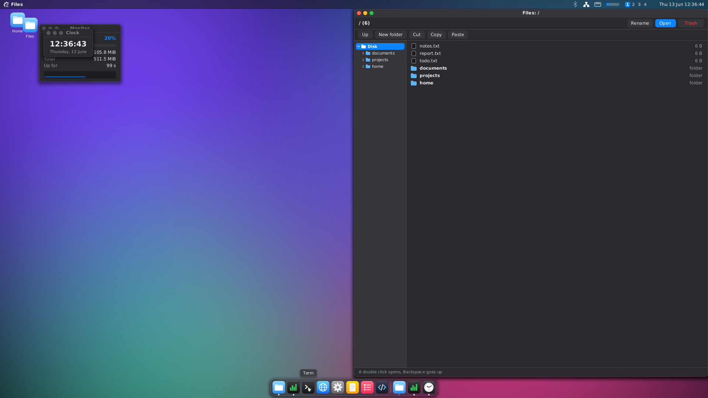
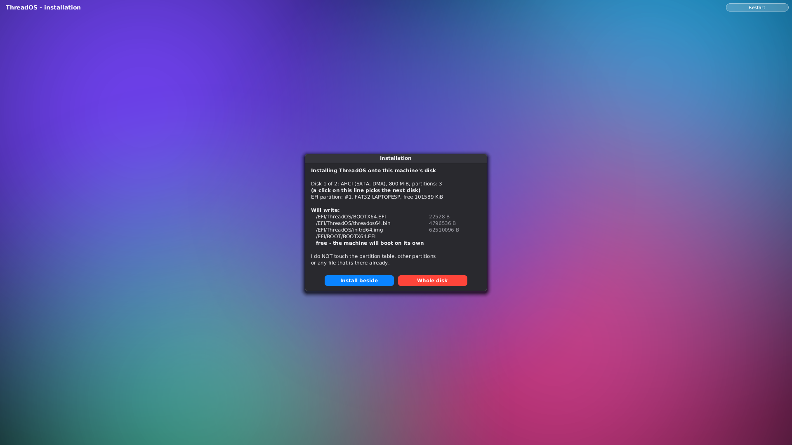
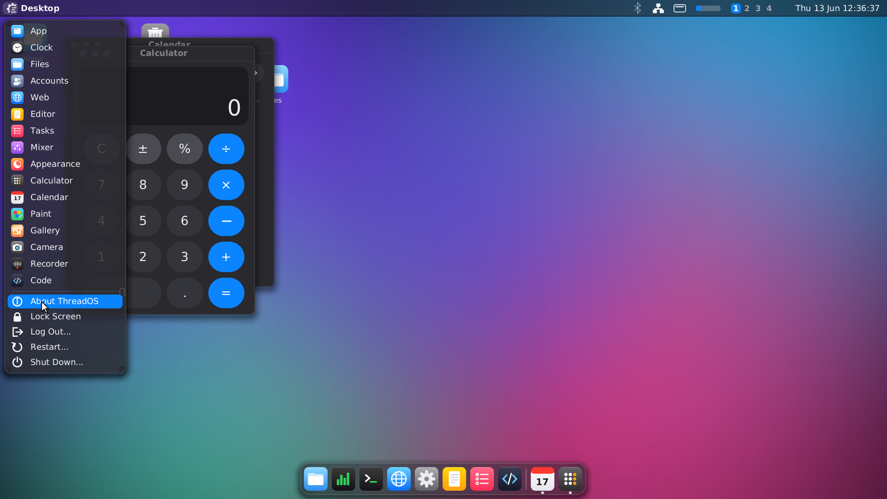
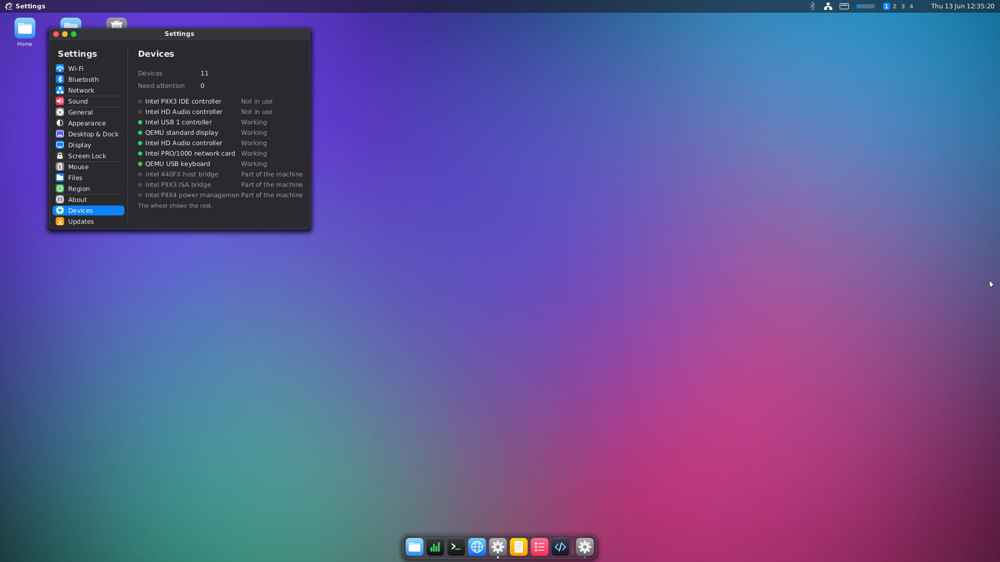
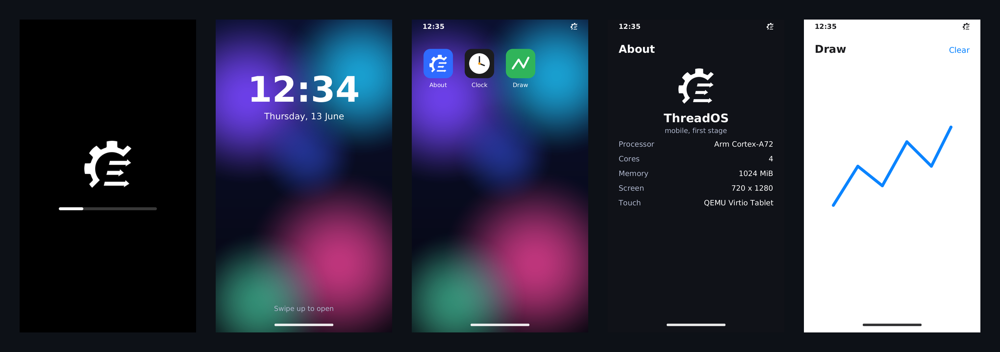

# ThreadOS

[](LICENSE)
[](https://github.com/DaniuPl/ThreadOS/releases/latest)
[](https://discord.gg/AyaEyTSG6)

ThreadOS is an operating system for x86-64 PCs, written from scratch in C
and assembly. It has its own kernel, drivers, filesystem, TCP/IP stack,
TLS 1.3, UEFI boot loader, installer and compositing desktop. It runs in
QEMU and on real UEFI PCs; an ARM64 kernel is on its way.



| | |
|---|---|
|  |  |
|  |  |

All of them are what QEMU's screen showed on a 1920x1080 panel
(`scripts/screenshots.py`).

**ThreadOS mobile** - the ARM64 kernel as a phone, on QEMU's `virt`
machine (`make run-phone`): the loading screen, the lock screen, home,
About and Draw, each 720x1280 as QEMU shows it, at half size.



- [Architecture](#architecture)
- [Installing on a PC](#installing-on-a-pc)
- [Building](#building)
- [Running in QEMU](#running-in-qemu)
- [Testing](#testing)
- [Repository layout](#repository-layout)
- [Maintenance](#maintenance)
- [Features](#features)
- [Roadmap](#roadmap)

## Architecture

**One PC kernel, and an ARM64 one on its way.**

| | x86-64 kernel |
|---|---|
| Mode | long mode, 4-level paging with NX |
| Sources | `boot64/`, `kernel64/` + the shared part of `kernel/` |
| Syscalls | `syscall`/`sysret` (`kernel64/syscall64.c`) |
| Boots via | Multiboot 2 (GRUB) or threadboot (UEFI) |
| Output | `build/threados64.bin` + `build/initrd64.img` |

Drivers, the filesystem, the network stack, the window compositor and
most of the kernel live in `kernel/` (the list is `SHARED64` in the
`Makefile`); what depends on long mode - paging, interrupts, context
switching, the syscall entry and process setup - is in `kernel64/`. A
32-bit protected-mode kernel was built from the same files until it was
removed; its tests now run on this one.

The ARM64 kernel (`bootarm64/`, `kernelarm64/`, for QEMU's `virt`
machine) boots, reads the device tree, catches exceptions, runs with the
MMU on, takes timer interrupts through a GICv2 and runs preemptive kernel
threads on every core it wakes through PSCI. Given a phone's devices it
is ThreadOS mobile: a screen (QEMU's ramfb, which it sets up at 720x1280
through fw_cfg), a touchscreen (virtio-input over virtio-mmio), the time
(PL031) and the initrd with the fonts (through fw_cfg), and on them a
first shell - a lock screen, home, and the About, Clock and Draw apps -
drawn by the PC's own graphics, fonts and mark. Of `kernel/` it builds
`string.c`, `heap.c`, the graphics (`gfx.c`, `ttf.c`, `uitext.c`,
`mark.c`, `aurora.c`), `fonts.c`, `initrd.c` and `locale.c`; the rest
follows as shared code stops assuming x86.

**Boot paths (64-bit).**

- BIOS or UEFI with GRUB: `build/threados64.iso` boots GRUB, and GRUB
  loads the kernel and initrd through Multiboot 2.
- UEFI with threadboot (`boot/efi/efiboot.c`), the project's own PE32+
  loader. It reads `threados64.bin` and `initrd64.img` from the EFI system
  partition, sets a GOP mode (the panel's native resolution, from EDID),
  builds the Multiboot 2 tags itself (memory map, framebuffer, ACPI RSDP,
  EFI system table), exits boot services and jumps to the kernel. The
  installer and the USB image use this path. The kernel keeps the UEFI
  runtime services, which it uses to write firmware boot entries.

**Userland.** Programs are freestanding ELF files packed into the initrd
(`scripts/mkinitrd.py`). They can also be run from disk. Sources in
`user/` reach the kernel through `user/uapi.h` (`user64/usys64.h` +
`user64/compat64.h`); `user64/` holds programs of its own. Crypto, TLS, HTTP and DNS are header-only code. The programs
that use them link against `libthread.so`, which the kernel maps into
every process once. Programs can also be built
against musl (`libc/`, with upstream musl in `third_party/musl`). `js`
(QuickJS) is built this way. Such programs have POSIX threads: mutexes,
condition variables, semaphores, thread-local variables, and threads that
run on every core (`libc/tests/pthreadtest.c`). SQLite (`sqlite3`) is the
first library brought in whole: the upstream amalgamation, built
unchanged. They have BSD sockets too (TCP and UDP over the
kernel's stack, poll and select, getaddrinfo through the system's name
server). zlib and curl are built from their release archives;
`curl` runs in the terminal. The browser draws a page's own fonts with
FreeType and shapes them with HarfBuzz. For WebKit, JavaScriptCore runs
(`jsc`), and the libraries WPE's port of WebKit is built on - GLib,
libsoup, OpenSSL, ICU, fontconfig, HarfBuzz, libxml2, libwebp, libgcrypt
and more - are built from their releases into `BUILD/libs64`, each tested
on ThreadOS.
C++ programs use the host compiler's libstdc++ on top of musl, without
exceptions (`libc/cxx/`). The first is litehtml (`third_party/litehtml`),
an HTML/CSS layout engine, which lays pages out on ThreadOS exactly as
it does on Linux. The 64-bit web browser (`apps/browser/web.cpp`) draws
its pages.

**Graphics.** The compositor (`kernel/desktop.c`) runs in the kernel. It
draws with `kernel/gfx.c` (anti-aliased shapes, shadows, blur) and
`kernel/ttf.c` (a TrueType rasteriser that matches FreeType with hinting
off). Ring 3 programs draw into their windows through system calls, using
the same primitives (`user/udraw.h`) and a small widget kit
(`user/ugui.h`).

## Installing on a PC

Each [release](https://github.com/DaniuPl/ThreadOS/releases/latest) (built
when one is started by hand, see [Releases and updates](#releases-and-updates))
carries:

| Asset | Contents |
|---|---|
| `threados64.iso` | Hybrid BIOS/UEFI disc: starts the installer |
| `threados-stick.img.xz` | Raw GPT disk image for a USB stick (UEFI only) |
| `update.txt`, `threados64.bin`, `initrd64.img`, `BOOTX64.EFI` | A signed system update |

1. Write `threados64.iso` to a USB stick: Rufus in **DD image** mode,
   balenaEtcher, or `dd if=threados64.iso of=/dev/sdX bs=4M conv=fsync`.
2. Disable Secure Boot. threadboot is not signed.
3. Boot from the stick. The installer starts by itself, with no menu
   (on a UEFI machine, Esc in the first second shows the one other
   entry, which adds an installed ThreadOS to the firmware's boot
   menu). There are two modes:
   - *beside another system*: copies three files into `\EFI\ThreadOS\` on
     the existing EFI partition and adds a boot entry at the end of the
     boot order;
   - *whole disk*: writes a new GPT, a FAT32 EFI partition and a TFS3 data
     partition, and adds a boot entry first in the boot order.
4. Updating an installed system: `run update check`, then
   `sudo run update`. See [Releases and updates](#releases-and-updates).

## Building

### Prerequisites

Debian/Ubuntu:

```sh
sudo apt-get install build-essential make python3 \
    qemu-system-x86 grub-pc-bin grub-efi-amd64-bin xorriso mtools \
    ovmf clang lld openssl cmake ninja-build ruby pkg-config gperf bison
python3 -m pip install --user meson     # 1.4 or newer, for GLib
```

| Needed for | Packages |
|---|---|
| the kernel and initrd | `gcc`, `make`, `python3` |
| the libraries in the initrd (JavaScriptCore, GLib, fontconfig, libxkbcommon) | `cmake`, `ninja-build`, `ruby`, `pkg-config`, `gperf`, `bison`, meson 1.4 or newer |
| discs (`iso`, `iso64`) | `grub-pc-bin`, `grub-efi-amd64-bin`, `xorriso`, `mtools` |
| threadboot (`efi`, `stick`) | `clang`, `lld`, `mtools` |
| running and testing | `qemu-system-x86`, `ovmf`, `openssl` |
| optional tests and tools | Python `freetype-py` and `fonttools` (font tests), `Pillow` (screenshots), Node.js (JavaScript comparison tests), `libglib2.0-dev` and `libfontconfig-dev` (the GLib and fontconfig comparison tests), Python `h2` (the HTTP/2 server of the libsoup test), Python `cryptography` (the WPE libraries' test) |

A test that is missing an optional tool prints `SKIPPED` and the reason.

### Targets

| Command | Produces |
|---|---|
| `make` (or `make kernel64`) | `build/threados64.bin`, `build/initrd64.img` |
| `make efi` | `build/BOOTX64.EFI` (threadboot) |
| `make webkit` | `build/weft.tapp`: Weft, the browser on WebKit's WPE port, as an application package (hours on four cores, so not part of `make`; `TAPP_KEY=key.pem` signs it) |
| `make kernelarm64` | `build/threados-arm64.elf`, the ARM64 kernel for QEMU's virt machine (clang + lld), and `build/initrd-arm64.img`, its fonts. `make run-arm64` boots it on the serial console, `make run-phone` as a phone with a screen and a touchscreen (the mouse is the finger) |
| `make iso64` | `build/threados64.iso` (builds the 64-bit kernel and threadboot first) |
| `make stick` | `build/threados-stick.img` |
| `make libc64` | musl for ThreadOS (built automatically when needed) |
| `make browser` | litehtml and its layout test, for ThreadOS and for the host |
| `make clean` | removes `build/` |

Variables:

| Variable | Meaning |
|---|---|
| `BUILD=<dir>` | build somewhere other than `build/` |
| `VERSION=<n>` | system version written into the initrd (default `0`) |
| `KVM=1` | use `/dev/kvm` in the `run` targets |
| `AUDIO=pa\|pipewire\|alsa` | attach an Intel HDA card to the `run` targets |
| `T=a,b` / `J=n` | test groups to run / how many at once (`make test`) |

`-j` works for all targets. Most of a clean build's time - about twenty
minutes on four cores - goes to the libraries for WebKit: JavaScriptCore,
ICU, GLib, OpenSSL.

## Running in QEMU

```sh
make run              # the system from the hybrid disc, to the desktop
make run KVM=1        # with hardware virtualisation
make run-iso64-uefi   # the hybrid disc under OVMF
make run-stick        # the USB image under OVMF, exactly as a PC boots it
make run-phone        # ThreadOS mobile: the ARM64 kernel with a screen and touch
```

The serial console is on stdio. The kernel logs everything there, which
makes it the first place to look when something goes wrong. Inside the
system, `devices` lists every device and what became of it (the Device
Manager in Settings shows the same), `hardware` the PCI bus in detail and
`disks` the block devices.

## Testing

```sh
make test                   # every group, 4 at once
make test T=files,filetree  # selected groups
make test J=8               # more parallel VMs
make fuzz                   # parsers under ASan/UBSan on the host (GLib's
                            # need meson, libffi-dev and libpcre2-dev)
```

The suite (`scripts/run_tests.py`) has 166 groups and thousands of
assertions. Each group is one file, `scripts/tests/t_<group>.py`. It
boots a real kernel in QEMU and checks the system from outside:

- the screen, through QMP screendumps. Text is read back glyph by glyph
  in the system's own fonts (`scripts/ptest.py`).
- the serial port, and keyboard and mouse input sent through QMP.
- disk images read back with `mtools` and a GPT parser.
- OVMF, which boots an installed disk or fails to.
- independent implementations used for comparison: OpenSSL (ciphers,
  TLS, signatures, through the openssl tool and Python's cryptography),
  FreeType (fonts, and the ThreadOS mark), Pillow (pictures), the host's
  GLib and fontconfig, Python's ElementTree and unicodedata, Node.js
  (JavaScript), glibc (libc output).

A full run takes 20–30 minutes on four cores with KVM.

To run tests against a build that is not in `build/`, pass the images
explicitly:

```sh
make BUILD=/tmp/b -j8 all efi
python3 scripts/run_tests.py -tfiles /tmp/b/threados64.bin /tmp/b/initrd64.img
```

Do not rebuild `build/` while a test run is using it.

The network groups run a DNS server on host port 53, because QEMU's user
network sends guest DNS queries there. Run them as root, or once run
`sudo sysctl -w net.ipv4.ip_unprivileged_port_start=53`.

CI: `.github/workflows/build.yml` builds everything and runs a
cross-section of groups. It is started by hand from the Actions tab.

## Repository layout

```
boot/            the GRUB menu of the disc (grub64.cfg)
boot/efi/        threadboot, the UEFI loader
boot64/          long-mode entry, ISR and syscall stubs, AP startup
kernel/          kernel code that does not depend on long mode; headers in kernel/include/
kernel64/        long-mode kernel code, linker script
bootarm64/       ARM64 entry (EL2 -> EL1, stack, .bss, further cores), exception vectors, thread switch
kernelarm64/     ARM64-only kernel code: PL011 serial, device tree, MMU, GIC, timer, pages, threads, PSCI,
                 fw_cfg, the ramfb screen, PL031 clock, virtio-mmio, the touchscreen, the mobile shell
user/            ring 3 programs and the header-only libraries (crypto, TLS, HTTP, GUI kit)
user64/          programs of their own, the syscall layer
libc/            musl port: replaced files (overlay/), linker script, tests
apps/js/         the QuickJS host (`js`)
apps/browser/    the litehtml browser: its test, and the patches to litehtml
third_party/     unmodified upstream code: musl, QuickJS, litehtml, FFmpeg, SQLite, zlib, curl, FreeType, HarfBuzz, Brotli data
fonts/           DejaVu subsets used by the kernel and programs
scripts/         build helpers, release signing, test runner and tests
tests/fuzz/      host-side fuzzing harnesses
docs/            screenshots and the development journal
art/             the ThreadOS mark (SVG), which the loading screen draws
```

## Maintenance

### Adding things

| What | Where |
|---|---|
| a ring 3 program | `user/<name>.c` or `user64/<name>.c` (or `libc/tests/`, `apps/` for musl programs); add it to `USER64_ELFS` and to the `mkinitrd.py` lines of `$(INITRD64)`. Initrd names are at most 15 characters. |
| a system call | `kernel64/syscall64.h` (number), `kernel64/syscall64.c` (handler), `user64/usys64.h` (wrapper), plus `user64/compat64.h` if shared programs need it under its older name; for musl programs, `libc/overlay/src/threados/syscall.c` |
| a driver | `kernel/<name>.c`, `kernel/include/<name>.h`; add `<name>` to `SHARED64` |
| a test group | `scripts/tests/t_<name>.py`, registered in `GROUPS` in `scripts/run_tests.py` |

Test helpers read layout constants directly from C sources
(`_kernel_define()` in `scripts/ptest.py`). When you change a window
layout, keep its `#define`s as plain integers and update the helpers.

### Releases and updates

`.github/workflows/release.yml` runs when started by hand (Actions ->
release -> Run workflow), not on every push:

1. Builds with `VERSION=<workflow run number>`. The version is stored in
   the initrd as the file `version`.
2. Runs `scripts/mkupdate.py` to write `update.txt`: the version, then the
   size and SHA-256 of the kernel, initrd and loader. The last line is an
   ECDSA P-256 signature over everything before it.
3. Publishes the release `v<n>` with the update files, the ISO and the
   compressed stick image.

On an installed system, `update` (`user/update.c`) downloads `update.txt`
from `https://github.com/DaniuPl/ThreadOS/releases/latest/download/` and
checks the signature against the public key compiled into the program.
It then checks every file's size and hash. Only after that does it write
the files to the EFI partition, through `SYS64_UPDATE_WRITE`, which is
admin only.

**The signing key.** The private key exists only in the repository secret
`THREADOS_UPDATE_KEY` (PEM, P-256). It must never be committed. To create
or rotate it:

```sh
openssl ecparam -name prime256v1 -genkey -noout -out update-key.pem
openssl ec -in update-key.pem -pubout -outform DER | tail -c 65 | xxd -p -c 65
```

1. Put the PEM in the secret.
2. Replace `official_key[]` in `user/usignkey.h` with the 65 printed
   bytes. The same key signs releases and application packages.
3. Release once. Systems older than that release will refuse updates
   signed with the new key until they are updated by hand, or until an
   admin writes the new key in hex to `update.key`.

### Application packages (.tapp)

An application that is not part of every system - Weft, the browser on
WebKit, is the first - comes as a package: one file in the initrd's
format, made by `scripts/mktapp.py`, with

- a `manifest` first: `ThreadOS app`, then `id`, `name` (`name.pl`),
  `version`, `arch` (`x86_64` or `aarch64`), `exec` (the program that
  starts it), and optionally `art` (the dock's picture) and `dock yes`;
- the programs and data, under the names they are run and read by;
- a `signature` last: ECDSA P-256 over the SHA-256 of every byte before
  it, made with the key that signs releases.

threadboot loads every `*.tapp` in `\apps` (a stick) and
`\EFI\ThreadOS\apps` (an installed system), GRUB those in `/boot/apps`
on the disc, and the kernel takes each one that is a package for its
processor: its programs run by name after the initrd's (a package cannot
replace a program of the system's), and `dock yes` gives it a tile. The
installer copies them to `\EFI\ThreadOS\apps`. `tapp` lists them,
`tapp info FILE` shows what a package holds, `tapp verify NAME`
checks a package - one the system has, or a file - against the system's
key, and `sudo run tapp install FILE` puts a package signed by that key
onto the installed system: into `\EFI\ThreadOS\apps`, its programs
running at once and its tile in the dock. A double click on a `.tapp`
in the Files app, on the Desktop or in the search opens `gtapp`, a
window that says what the package is and whether it is signed, and
installs it with one button (asking for the administrator's password
when the session does not have the right). The EFI partition is as trusted as the kernel on it, so packages a
loader finds there are not checked at boot.

```sh
python3 scripts/mktapp.py hello.tapp --id hello --name Hello --version 1 \
    --arch x86_64 --exec hello --dock --key key.pem hello=build/user64/hello64.elf
python3 scripts/mktapp.py --info hello.tapp
```

### Generated files

These files are committed. Regenerate them only when their inputs change:

| File | Generator |
|---|---|
| `fonts/*.ttf` | `scripts/mkfonts.py <dir with DejaVu fonts>` (needs fonttools) |
| `user/caroots.h` (built-in CA roots) | `scripts/mkcaroots.py` (reads the host CA bundle) |
| `user/certdata.h` (certificate test data) | `scripts/mkcertdata.py` (needs openssl) |
| `docs/*.png` | `scripts/screenshots.py` (needs a built system, OVMF and Pillow) |

### Third-party code

`third_party/` holds upstream releases, trimmed but not modified. See
`third_party/README.md` for versions and what was left out. To update
one, replace its directory. ThreadOS-specific changes to musl live in
`libc/overlay/`, changes to litehtml as patches in `apps/browser/patches/`.
QuickJS is wrapped by `apps/js/`. After an update, run
`make test T=libc`. New libraries are welcome. CONTRIBUTING.md says
what bringing one in involves.

## Features

- **Desktop:** a compositor with a glass menu bar, a dock, rounded
  windows with shadows, dark and light themes, wallpapers, animations,
  notifications, search (Ctrl+Space), four virtual desktops, snapping
  and Alt+Tab. It runs at the panel's native resolution, with HiDPI
  scaling. It starts behind a loading screen of the ThreadOS mark and a
  bar.
- **Programs:**
  - file manager (folder tree, cut/copy/paste)
  - terminal (Tab completion, pipes)
  - text editor
  - web browser (litehtml, HTML and CSS)
  - settings, task manager, calculator, calendar, paint, mixer
  - picture viewer (PNG, JPEG, BMP)
  - 64-bit media player (MP3, WAV, AAC, FLAC, Ogg, M4A, MP4/MOV, Matroska, AVI)
  - installer
  - `update`
  - `js` (QuickJS)
- **Hardware:**
  - storage: AHCI, NVMe and ATA
  - USB: xHCI, EHCI and UHCI host controllers; HID keyboard and mouse,
    mass storage, RNDIS Ethernet and Bluetooth HCI
  - network cards: RTL8139, RTL8111/8168 and e1000, wherever they sit -
    on the chipset's bus or behind a PCI Express port, as in a laptop
  - Intel HD Audio: of a machine's controllers, the one with the speakers
  - Wi-Fi: the Intel Wireless 3160 starts and scans
  - PS/2 keyboard and touchpad with wheel
  - ACPI, SMP
- **Kernel:**
  - processes and threads on all cores; `fork`/`exec`, copy-on-write,
    demand paging and swap
  - signals, pipes, shared memory, memory-mapped files
  - shared libraries
  - users, an admin role and `sudo`
- **Storage:** TFS3, our own filesystem (directories, files up to
  64 MiB), and FAT12/16/32 with long names.
- **Network and security:**
  - ARP, IPv4, ICMP, UDP, TCP, DHCP and DNS
  - TLS 1.3 with X.509 validation
  - AES-GCM/CCM, ChaCha20-Poly1305, X25519, ECDSA, RSA, SHA-1/2
  - WPA2 key derivation
- **Weft, the browser on WebKit:** WPE WebKit 2.54 with tabs, back and
  forward, an address field and the dock's Web tile (`make webkit`
  builds it into the package `weft.tapp`, which the loader brings
  beside the initrd and the installer writes onto the installed
  system): pages
  fetched by libsoup, laid out by WebCore exactly as Chromium lays them
  out, scripts in JavaScriptCore, painted by Skia on the processor,
  with the mouse and the keyboard (Polish letters too).
  Under it, built from source and tested on ThreadOS against other
  implementations: GLib, libsoup, OpenSSL, ICU, FreeType, fontconfig,
  HarfBuzz, libxml2, libpng, libjpeg-turbo, libwebp, libgcrypt,
  libtasn1, libepoxy and libxkbcommon.

## Roadmap

- Wi-Fi: joining a network with the Intel 3160 (it scans already) and
  an 802.11 layer. The WPA2 cryptography is already done.
- Applications as `.tapp` packages: a manifest, an icon, the programs
  and a signature in one file, installed with a double click; Weft
  becomes the first of them.
- Weft on ARM64: programs in user mode, the network, and WebKit built
  for aarch64.
- Drivers for what laptops still list without one: the SD card reader,
  the SMBus.
- Images and external style sheets in the browser.
- Removing the big kernel lock from drivers, the filesystem and swap.

## Contributing, security, license

- **[Discord](https://discord.gg/AyaEyTSG6)**: questions, ideas, screenshots from real hardware, and
  help with getting ThreadOS to boot on your machine.
- [CONTRIBUTING.md](CONTRIBUTING.md): review rules. The first one is that
  every feature comes with a test that would fail without it.
- [AGENTS.md](AGENTS.md): instructions for AI coding assistants.
- [SECURITY.md](SECURITY.md): reporting vulnerabilities, and the update
  trust model.
- [docs/JOURNAL.md](docs/JOURNAL.md): the development journal, with the
  reasoning behind every major decision.

Licensed under the MIT license (see [LICENSE](LICENSE)). `third_party/`
keeps each project's own license (MIT, BSD, Apache-2.0, LGPL; see
[third_party/README.md](third_party/README.md)). `fonts/` is under the Bitstream Vera /
DejaVu license ([fonts/LICENSE-DejaVu.txt](fonts/LICENSE-DejaVu.txt)).
